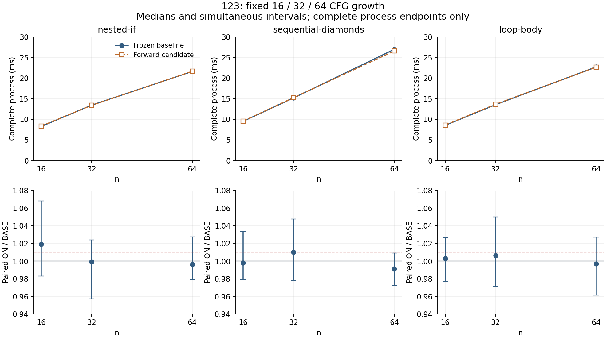

# 123：DAG初始化消重未获得完整编译成本准入

**最终裁决：Inconclusive，生产净回退。** 两个候选完成了真实实现、完整候选等价和实际编译矩阵；最终一次固定确认没有证明完整编译变快。初始化transfer次数减半和确定性预算下降不是上线性能成绩。

## 身份与范围

- 基线：`ff0ddb7e59b2b0577c35b92e74b895c86f20b218`。
- 第一候选：`c83b3c5b916b945ecc54b3aa0d23da7a60dbac3b`，单块特化、Kahn DAG求解、原循环回退。
- 第二候选：`5732c9edaa49a8d4e93045201cc13f4e6cda938a`，在原CFG建边中识别全向前边；一次顺序求解，其余多块图准确回退旧scan。
- 正式控制器：`29d148ab1c60830df068f95f5dadf48b8b75050b`。
- 净回退：`c80d0d6d0a5ff358fd5828314820034fbdd0d42a`；相对基线`Cargo.toml`、`Cargo.lock`、`crates`零净差。
- schema17、默认限额、独立Verify、旧101/107合同及裁决、产品性能门保持原样。本研究不声称Rust整体性能胜出。

## 先纠正被真实源码否定的假设

最初将BlockId可能不是拓扑序当作当前源码的重复扫描机会。穷举raw方程确实需要处理逆编号DAG，但原三族普通源码16/32/64的基线transfer只是100/196/388次，约两遍。另固定构造带局部变量的嵌套校验/提前返回4/16/32/64源码，得到41/149/293/581次，约三遍；这些源码的join由前端排在嵌套体后。这里没有实证二次到线性的改善。

第一候选在没有对应反复扫描的前端常见DAG上，反而支付Kahn表、前驱计数、队列和一次不可达块扫描。8个空块链的确定性预算从原184单位增加到246单位（另加相同target文本收费）；这个反例保留。第二候选复用建边访问的严格前向条件，取消这些额外表/遍历，空链预算恢复184；没有继续扩建通用调度平台。

第二候选单块和严格向前图只删除原重复集合代入/比较/稳定确认，其余图保留原scan，完整候选观察相等、现有逻辑工作预算不增加的有限证明见[PROOF.md](PROOF.md)。证明不适用于物理耗时，不豁免墙钟实验。Rust MIR的RPO/dirty调度和Clang RPO/WTO源码是已有方法参考，并不意味着本实现比它们更先进。

## 功能和失败原件

两版各通过4252个最多三块的方程模型观察及额外四块重复边、逆编号、不可达环/不可约环对照；这些模型不冒充合法完整TypedIR。两版的实际源码集成各3项，包含4次O0/O2原生执行、direct/wire伪造候选拒绝、真实未初始化raw路径、N/N−1与失败后恢复；Analyze 25单元、12预算、5 package预算通过。第二版另核非向前多块solver的每个失败预算直至首个成功预算，和原scan逐项相同。

两版各执行28模式、BASE/ON × plain/diag ×4请求，即448请求的完整阶段/公开观察对照，并各执行48次真实Build产物。独立Verify每个成功请求仍执行一次。第二版迁移执行路径后，另外56个无dump公开控制进程、224请求和48次原生执行建立新functional-anchor。迁移不把原路径指纹改写成新路径指纹，因为绝对源路径参与project fingerprint。

初次3个旧预算精确N断言失败、模型测试parity lint、稀疏工作树缺已有conformance include、研究构建缺transitive guards_extra源码均保留。预算修订先提案，默认限额未增加；单块100常量减少101真实单位，两个单块函数减少14单位。失败、修复与限定命令见[作者功能收据](../../../evidence/impl/123/author-functional.json)。

## 有限探索没有升级为确认结论

第一版固定4块探索560进程，旧19完整进程等权比0.99305；95端点42个点估计超过1.01，nested-if64完整进程约1.135。第二版新/tmp目录固定4块探索560进程，旧19完整进程等权比0.98213；95端点23个点估计超过1.01，loop-body32约1.152，sequential-diamonds32约1.079。两轮路径和共享环境不同，不能将比值之差当作二版相对一版的独立收益。

第二版探索中的约1.79%下降没有在后续固定确认中保持。增长点的大回退也未稳定复现；两者都不能按有利方向选取。

## 唯一正式确认

2026-10-26 02:00:07Z–02:09:27Z，在root协调无构建窗口、CPU2完成固定7280进程/29120请求，112暖进程、7168保留进程。19原模式95端点与9增长模式45端点全部保留，再加入历史19和全部28完整进程的固定等权汇总，共142族。每模式64个ABBA/BAAB区块，两种顺序各32个；中位块比值和第18/47次序区间见[固定确认合同](CONFIRMATION.md)。

每请求原始/替换源SHA、完整公开语义及LLVM锚、固定且唯一的报告路径、命令/退出/stdout/stderr、首末窗口、正整数时间、API+销毁不超过完整进程、JSON/JSONL同一性全部通过。非作者独立重算7280报告、29120请求、603200来源SHA，并在之后比较10076项数值，与作者统计一致。

窗口内记录了一次root约0.8秒的稀疏源码worktree checkout，无构建/native/压缩；准确起止未知，原样保存背景事件，不删除任何对应样本，不声称宿主完全静默。名义区间仍依赖块稳定且足够独立。

| 固定加权汇总 | ON/BASE点估计 | 142族同时区间 | 判定 |
|---|---:|---:|---|
| 原19模式完整进程，各1/19 | 1.00204404 | [0.99332335, 1.01175672] | 未证明下降 |
| 全部28模式完整进程，各1/28 | 1.00324382 | [0.99651791, 1.00982750] | 未证明下降 |

140单项中，136项区间上界超过1.01（历史93/95、增长43/45），0项区间下界超过1.01；22项点估计超过1.01（历史16、增长6）。因此既没有正式证据证明某项超过1%的回退，也没有证明全矩阵无超过1%的回退。两个预定加权汇总的上界也都未低于1。当前结论是完整成本未准入，不能描述成“已提速、只是审批未过”。

### 原19模式的完整进程

成本列是64块中每臂两次成本均值的中位数；比值是各块ON/BASE的中位数，故不等于两成本中位数的直接相除。全部API端点、前后半和首臂差异见[完整统计JSON](../../../evidence/impl/123/results/confirmation-summary.json)和[140端点CSV](../../../evidence/impl/123/results/endpoints.csv)。

| 模式 | BASE ms | ON ms | 配对比值 | 同时区间 |
|---|---:|---:|---:|---:|
| alias-cycle16 / verify | 29.931 | 29.930 | 0.99914 | [0.97107, 1.01597] |
| bytes-main / build | 212.742 | 212.988 | 0.99565 | [0.98420, 1.01133] |
| bytes-main / verify | 16.469 | 16.552 | 0.99860 | [0.96444, 1.03097] |
| bytes-main-used / build | 210.091 | 208.937 | 0.98808 | [0.97723, 1.00867] |
| bytes-main-used / verify | 12.329 | 12.486 | 1.00603 | [0.97968, 1.03535] |
| fanjoin16 / verify | 15.745 | 16.039 | 1.02096 | [0.98895, 1.05687] |
| forward128 / verify | 40.400 | 40.813 | 1.00848 | [0.99078, 1.02343] |
| modules512 / verify | 205.943 | 208.455 | 1.01269 | [0.98762, 1.03332] |
| owned-bytes-main / build | 212.637 | 210.793 | 0.99353 | [0.97521, 1.01406] |
| owned-bytes-main / verify | 14.221 | 14.188 | 1.00394 | [0.96889, 1.04232] |
| owned-bytes-main-used / build | 206.302 | 205.092 | 0.99513 | [0.97958, 1.01606] |
| owned-bytes-main-used / verify | 11.840 | 11.753 | 1.00065 | [0.96609, 1.02528] |
| owned-main / build | 261.948 | 262.806 | 1.00105 | [0.98359, 1.01683] |
| owned-main / verify | 40.821 | 41.379 | 1.00753 | [0.98276, 1.02791] |
| owned-main-used / build | 253.127 | 252.695 | 0.99763 | [0.98315, 1.02581] |
| owned-main-used / verify | 29.024 | 28.862 | 0.99773 | [0.97507, 1.01544] |
| reverse128 / verify | 61.708 | 61.691 | 1.00368 | [0.99118, 1.01948] |
| swap16 / verify | 13.367 | 13.166 | 0.99448 | [0.95688, 1.02402] |
| tiny / verify | 2.752 | 2.776 | 1.01609 | [0.93692, 1.18619] |

### n/2n/4n增长完整保留

本轮九个增长点两臂均完成，没有用ResourceLimit代替时间比，没有删容量失败后重分配权重。以下是实际完整进程成本，原始值/逐次增长倍数见[growth.json](../../../evidence/impl/123/results/growth.json)。

上排为完整进程成本；下排为同一九个完整进程端点的配对比值及142族区间，灰线为1，红虚线为1.01。图中没有省略增长点；其余131个API/历史端点仍在完整表中，不能只凭这九项判定准入。

| 结构 | n | BASE ms | ON ms | 配对比值 | BASE/ON相对n=16增长 |
|---|---:|---:|---:|---:|---:|
| nested-if | 16 | 8.248 | 8.354 | 1.01919 | 1.000× / 1.000× |
| nested-if | 32 | 13.429 | 13.377 | 0.99940 | 1.628× / 1.601× |
| nested-if | 64 | 21.589 | 21.634 | 0.99636 | 2.617× / 2.589× |
| sequential-diamonds | 16 | 9.514 | 9.569 | 0.99800 | 1.000× / 1.000× |
| sequential-diamonds | 32 | 15.173 | 15.244 | 1.01011 | 1.595× / 1.593× |
| sequential-diamonds | 64 | 26.970 | 26.557 | 0.99139 | 2.835× / 2.775× |
| loop-body | 16 | 8.529 | 8.597 | 1.00294 | 1.000× / 1.000× |
| loop-body | 32 | 13.532 | 13.634 | 1.00627 | 1.587× / 1.586× |
| loop-body | 64 | 22.716 | 22.648 | 0.99694 | 2.663× / 2.635× |

从16到64，三族候选完整进程分别增长约2.589、2.775、2.635倍，与本轮基线相近。没有观察到本轮三档规模上的猛增，仍不能据此证明一般渐近复杂度或任意规模无退化。候选parent峰值VmHWM 26216 KiB，基线26204 KiB；该值不包含clang子进程，不是目标程序运行内存结论。

## 进一步定位：减少的工作不是主要完整成本

正式完成后，原冻结diag二进制对22个Verify案例各执行BASE/ON一次，共44臂；这些是无dump、带探针、共享环境下的单次归因，完全不进入正式时间样本。冷请求基线摘录如下；整个Analyze阶段也含预检、指纹和资源/Hold等工作，并非只包含本次初始化solver。

| 案例 | API ms | 整个Analyze ms | raw_digest ms | Types effects ms | BASE→ON transfer |
|---|---:|---:|---:|---:|---:|
| modules512 | 66.362 | 1.028 | 26.567 | 0.0003 | 1026→513 |
| nested-if64 | 6.384 | 0.272 | 4.354 | 0.0003 | 388→194 |
| reverse128 | 26.924 | 1.805 | 9.301 | 9.982 | 260→130 |
| owned-main | 12.757 | 3.802 | 4.670 | 0.0083 | 342→172 |
| loop-body64 | 7.679 | 0.408 | 4.928 | 0.0002 | 593→592 |

这些观察解释了为何不能把transfer计数减半外推为全编译提速：例如modules512整个Analyze仅约1.55% API，而重复raw_digest约40%；nested-if64的raw_digest约68%。reverse128的参数效果闭包约37%，是另一个真实重项。本轮没有单独给初始化solver做无探针独立计时，不把整个Analyze的时间差归因于它。diag两臂的时间变化也不能当正式速度比。完整44臂记录见[归因原件](../../../evidence/impl/123/results/post-diagnostic.json)及[冷请求摘要](../../../evidence/impl/123/results/cold-diagnostic-summary.json)。

后续研究优先重核107的重复身份编码与101的参数效果闭包，依据当前源码/依赖完整性推进；旧候选与原Inconclusive保持。RPO/SCC或idom/dominance表示仍可研究，但须先用真实源码和完整请求剖面证明热点，不再仅因看见循环或有raw逆编号模型就选择实施。Verify仍须独立重建，不能以共享Analyze结论省掉安全检查。

## 输入漂移与原件边界

第二版原/workspace工作输入在所有功能臂完成后出现seq32的public_edit字节残留，首次探索前完整输入SHA检查拦截。四个该案例的功能原件cold/unchanged均记录冻结原SHA，随后作者和非作者核全112臂/448请求的源观察全部一致。现场原始mtime早于后续ON功能原件，ctime较晚；来源未确认，不能归因给harness或同步系统。旧目录不修复、不重封；新/tmp由固定原件重建并再次建立公开锚。

探索控制器的泛化CapacityOrFailure分支没有严格区分所有错误类型，这是独审指出的限制；本轮所有功能增长点均Pass，未触发。正式路径已要求28功能模式全部完成，任一失败/漂移/语义失配立即停止，不能把错误当容量跳过。该已冻结旧控制器保留，不事后伪称原来就有新防护。

## Rust四目标及本单成果

| 目标 | 本单实证 | 当前边界 |
|---|---|---|
| Rust同类安全 | 有限初始化等价、独立direct/wire拒绝、失败恢复；Verify源码未改 | 不是完整语言安全证明；最终未替换生产算法 |
| 运行/内存同级 | 真实源码O0/O2和研究Build的原生行为保持 | 未作本单Rust运行/内存计时比较，parent RSS不替代目标内存 |
| 表达/维护更简单 | 本单没有新增语言构造；纠正了不必要的通用调度开销 | 语言与ZUI能力增量由并行124–127各自交付 |
| 编译成本更低 | 两候选、反证、140完整成本端点及142族一次确认全部可复算 | 未证明完整编译改善，生产净回退 |
| 至少一项突破 | 建立有限语义/逻辑工作支配，并通过真实源码否定错误增长假设，定位更高占比成本 | 无产品级净性能突破，不以模型/测试数充当已落地速度成果 |

归档保留所有采样、失败、源码身份、输入、编译器二进制、全阶段原件、原生输出和source drift现场；每个压缩包逐member核SHA且保留展开原件供复查。独立审核和最终交付身份由root收口，作者不自审或自行合入。
