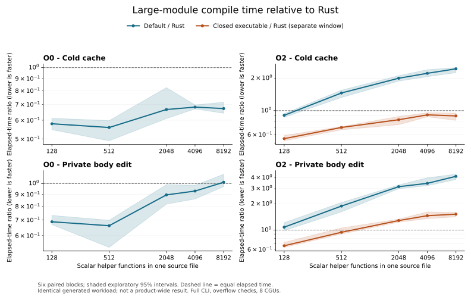
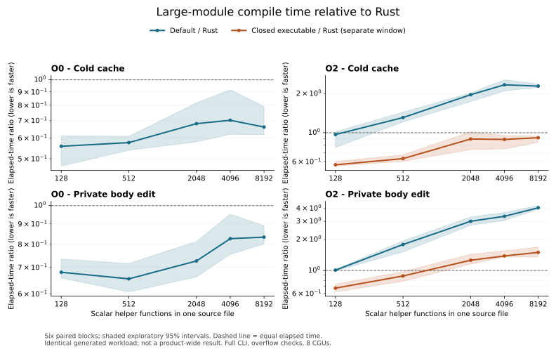
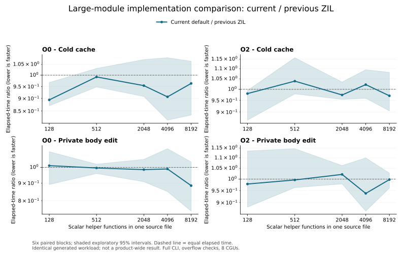

# 大模块分布、Rust对照与编译效率攻坚

本轮承接用户提出的三个问题：样本代表性、旧图切割/zit是否有效、同一工作负载与Rust的差距。原来的“很多小模块、每叶8函数”不足以代表大模块；扩大分布后，确实发现了默认O2、无改动重编译和类型实例容量上的明显差距。已落实大文件O0分块、显式封闭构建、支配树区间，以及后续机器预检优化，保留所有不利结果和默认限额失败。

专项分支 `research/incremental-compilation`，PR [#13](https://github.com/zil-lang/zil/pull/13)。广分布五窗生产为801933a9e，最终预检生产为59d8753dc；二者分别绑定自己的时间、ELF和源码，不能混成一次测量。main未合入，父任务仍Doing，产品门不变。

## 样本是否足够

新增23族生成程序，加14套已有独立ZIL/Rust程序，共37族。生成样本覆盖五档单文件规模、相同总函数数的均匀与偏斜分布、依赖链/高扇出、分支、泛型、CT、长函数体和名义类型实例。每个helper都通过聚合调用参与结果，检查完整4字节整数输出；私有修改分别落在首叶首函数、末叶末函数，并测试恢复原版本。

| 形状 | helper规模与叶模块分布 | ZIL文件数 | 最大ZIL文件字节 |
|---|---|---:|---:|
| 单文件 | 128 / 512 / 2048 / 4096 / 8192 | 各1 | 6,934 / 27,670 / 112,710 / 227,398 / 456,774 |
| 4096均匀 | 8×512 / 64×64 / 512×8 / 1024×4 | 9 / 65 / 513 / 1025 | 27,480 / 3,360 / 19,474 / 38,978 |
| 4096偏斜 | 2048,1024,512,256,128,64,32,32 | 9 | 112,520 |
| 8192均匀 | 8×1024 / 4×2048 | 9 / 5 | 55,176 / 112,520 |
| 8192偏斜 | 4096,2048,1024,512,256,128,64,64 | 9 | 227,208 |
| 分支/泛型/CT | 各64×16 | 各65 | 各2,522 |
| 64语句函数体 | 16×16 / 64×16 | 17 / 65 | 各8,240 |
| 名义类型泛型实例 | 16×16 / 32×16 / 64×16 | 17 / 33 / 65 | 1,433 / 1,433 / 2,522 |
| 链/高fanout | 各64×16 | 各65 | 956 / 2,522 |

文件数含root；最大文件可能是聚合root，不能把它当最大叶文件。helper数不含root/value/foreign或生成的泛型函数。最大单文件16,388行；长函数体失败族共68,868行，成功的较小函数体族17,220行。完整逐语言字节/行数在analysis.json；源码和每次编辑的文件SHA一并留档。

真实程序覆盖app、stream、slices、byte_io、byte_buffer、byte_buffer_owned、resources、resource_closures、error_cleanup、owned_component、package_ui、retained_ui、update_ui、helper_ui。源码不改，每个成功可执行文件跑15个输入，退出码/stdout/stderr逐项与独立Rust O0参考一致；部分程序忽略输入，不能算15条独立执行路径。app按已有源码说明对Rust传 `--check`，双方均检查同一内部结果。

这比原语料广得多，但仍是定向压力与小应用。没有随机抽样的大型企业项目、Cargo多crate依赖、Rust宏/trait规模、长时间编辑历史或Windows计量；不能据此宣布整个语言的编译性能胜出。Rust类型实例族使用derive Copy/Clone，ZIL按自身Copy规则处理，双方内部工作量也不相同。

## 广分布结果：大样本揭示了此前遗漏的差距

下面为801五窗的中位时间。默认窗口与封闭窗口各自交错测Rust，不把两个窗口当成一组配对差值。所有652单元、探索区间、RSS和失败见 [完整表](DISTRIBUTION-TABLES.md)。

| 8192 helper单文件 | ZIL ms | 同窗Rust ms | ZIL/Rust |
|---|---:|---:|---:|
| 默认O0冷构建 | 1163.567 | 1731.503 | 0.672 |
| 默认O0无改动 | 851.774 | 426.111 | 1.999 |
| 默认O0前部私有修改 | 1210.647 | 1195.618 | 1.013 |
| 默认O2冷构建 | 5363.392 | 2192.335 | 2.446 |
| 默认O2无改动 | 910.927 | 465.142 | 1.958 |
| 默认O2前部私有修改 | 5386.851 | 1294.342 | 4.162 |
| 显式封闭O2冷构建 | 1917.724 | 2148.115 | 0.893 |
| 显式封闭O2无改动 | 872.781 | 396.938 | 2.199 |
| 显式封闭O2前部私有修改 | 1893.783 | 1242.969 | 1.524 |

默认生成窗口315个有效单元中187个ZIL较慢；显式封闭窗口105个有效单元中51个较慢。长函数体16×16的默认O2无改动为359.846/131.467 ms、私有修改422.154/162.309 ms，差距仍大。不能只选冷构建或小例来描述增量效率。

14套真实小程序的默认84个单元和封闭28个单元，ZIL时间点估计均低于Rust。默认O0冷/无改动的等样本几何平均比为0.483/0.598，O2为0.484/0.587；这仅是这14例的条件汇总。小程序的启动、标准库与链接固定成本占比高，Rust还使用预编译标准库，不能由这些比值推导复杂大工程的优势。

### 与上一版ZIL的直接对照

同一冻结窗口9fe→801中，8192 helper O0冷构建1523.397→1148.890 ms，前部修改1502.266→1112.584 ms，末尾修改1532.984→861.832 ms，分别减少约24.6%、25.9%、43.8%。无改动1033.085→859.754 ms，减少16.8%。分块能复用其他单元；前部编辑仍可能重发包含大聚合函数的单元，收益随位置变化。

默认O2没有同等改善：该窗口8192前部修改5195.204→5263.339 ms（+1.3%点估计），cold也约+0.8%；对象不变时1005.983→923.085 ms（−8.2%）。全部80单元中21个时间点估计不利，探索区间都跨1；这不等于证明没有回归。不能把封闭模式的收益记到默认模式。

### 容量反例

body-64x16在Expand触发 `generic expansion budget exceeded`；types-64x16触发 `generic instance budget exceeded`，Rust均成功。后者当前硬上限为 `min(max_functions, 512)`，因此16/32模块类型族通过，64模块类型族失败。两族在五窗共240次拒绝，40个比较单元的速度比为空。拒绝耗时仍保留，但不参与有效速度汇总。没有调高默认预算来掩盖容量差距。

## 最终机器预检优化

59d另做9个预登记族、三个六区组窗口，共2700请求/225单元，全部编译与完整4字节原生结果有效。默认/封闭分别对Rust，隔离窗口直接比较801与59d；完整时间、RSS和区间见 [后续225单元表](PREFLIGHT-FOLLOWUP-TABLES.md)。以下是最终候选自己的数据。

| 8192 helper单文件 | 最终ZIL ms | 同窗Rust ms | ZIL/Rust |
|---|---:|---:|---:|
| 默认O0冷构建 | 1200.480 | 1818.227 | 0.660 |
| 默认O0无改动 | 755.106 | 481.478 | 1.568 |
| 默认O0前部私有修改 | 1092.106 | 1311.016 | 0.833 |
| 默认O0末尾私有修改 | 749.184 | 1196.709 | 0.626 |
| 默认O2冷构建 | 5551.528 | 2421.879 | 2.292 |
| 默认O2无改动 | 832.907 | 526.639 | 1.582 |
| 默认O2前部私有修改 | 5446.916 | 1337.788 | 4.072 |
| 显式封闭O2冷构建 | 2170.504 | 2372.091 | 0.915 |
| 显式封闭O2无改动 | 868.463 | 459.576 | 1.890 |
| 显式封闭O2前部私有修改 | 1981.366 | 1320.878 | 1.500 |

9个固定族的等样本几何平均比：默认O0冷构建0.637、无改动1.205、前/末部修改0.939/0.839；默认O2冷构建1.435、前部修改2.082；显式封闭O2冷构建0.717、无改动1.164、前部修改1.164。默认90个单元中45个时间不利，封闭45个中20个不利，RSS不利分别50/28个。它们是这9个族的条件汇总，不是语言总体分数。

**最后一项优化有明确但有限的增量收益。** 同窗801→59d中，8192 helper O2无改动构建1025.708→910.377 ms，减少11.2%，探索比值区间[0.813,0.924]。单CGU对象报告里的当前机器预检232.243→115.835 ms，完整请求只节约其中一部分。此时对象均为1 hit/0 miss，当前Verify照常运行；峰值RSS中位数291.50→290.12 MiB，没有总内存突破结论。

同窗O0末尾修改913.379→819.606 ms，减少10.3%，探索区间[0.781,0.974]。O0前部修改1356.783→1200.336 ms的点估计减少11.5%，但区间[0.746,1.037]跨1。O2前部修改5577.572→5566.668 ms，基本未变；主要时间仍在LLVM优化和代码发射。

隔离90个单元中24个时间点估计不利、34个RSS点估计不利。large-512/O2/unchanged为64.942→67.631 ms，+4.1%，探索区间[1.003,1.093]完全高于1；body-16x16/O0/unchanged为372.788→392.627 ms，+5.3%点估计。完整保留这些结果，不把局部热点的两倍改善称为所有编译的两倍改善。六区组和多单元比较的统计能力有限。

两轮正式计量共10524请求、877单元，40个原预算失败单元与全部不利点保留。正式有效原生构建8628次，对应22740次原生观察，另420次oracle；成功ZIL请求6042次各有当前Verify。两轮时间不相乘，也不把801的真实小应用计时重绑到59d；59d的完整37族重跑只作为源码组合控制。

## 已落地的四个切口

1. **5189：O0大文件分块。** 每文件256个非foreign LIR函数形成固定块，保留局部链接引用合并、入口和真实声明依赖；O2/count1/小文件保持原策略。只有生成函数集合与顺序未变时才保证局部稳定性，新增闭包/泛型实例仍可能扩大失效。
2. **c6a：显式封闭Linux可执行文件。** 从旧CP13移植 `--closed-executable`，默认关闭。只内部化精确当前LIR函数白名单中没有跨CGU使用的定义，保留取地址、全局初始化、foreign和入口约束；LLVM O2管线不变。该选项放弃生成符号的外部导出合同，不能默认为所有build开启。
3. **801：大图支配查询区间。** 保留原idom构造，以当前支配树DFS区间替代反复祖先爬链；独立SSA/phi和首错不变。
4. **59d：高扇入支配合并与局部符号查找。** 在一次当前idom树合并内缓存节点向首前驱祖先链的投影。只在前驱数同时不少于32和ceil(V/4)时使用，准备费受实际入边数的常数倍约束；小/稀疏汇合保留旧法。函数内defs/labels改用标准HashMap，定义检查仍按原输入顺序，输出/调度仍有序。05e仅32门槛的中间版本保留功能记录，未作为最终性能候选。

这些改动没有跨请求缓存Verified权限。每次源码成功请求仍独立Verify，对象命中仍验证当前机器输入。后续补丁没有使整个CHK支配构造算法变成线性；它去掉的是特定高扇入形状的重复路径工作，并限制新增准备成本。

## 图切割、zit是否发挥作用

完整归因与原始来源见 [ALGORITHM-ATTRIBUTION.md](ALGORITHM-ATTRIBUTION.md)。资源效果反向依赖调度有历史生产长链收益；完整关系切割/局部域在强直接算法对照下没有证明稳定净收益。zit的稳定owner、真实读取依赖、等值停止传播可借鉴，但当前编译器没有直接运行zit内核。本轮复现还发现，1100次始终无环的动态换边会产生103次高度循环报警；高度阈值不能作为编译图的环证明。

本轮大模块收益来自上述具体实现，不把旧BDD研究的88.8倍、080长链收益或zit机制复现包装成本轮Rust胜出。

## 尚未解决的架构差距

普通CLI每次创建新Session。当前 `--cache-dir` 持久化的是未核原始源码bytes，并不保存Rust那样的语义查询结果。源码未变时仍支付大量Expand/CT/Types/Analyze、当前Verify、Lower和机器输入构造；私有修改仍可能重做项目级语义阶段。对象命中只省去后端的一部分工作。现有BuildArtifact还要求发布LLVM文本侧文件，命中后仍有表示生成和产物成本；本轮没有将这份产物合同悄悄删掉。

Rust的可借鉴重点是稳定声明/实例身份、按实际读取建立依赖、签名/布局/效果/CT值/正文分面，以及结果等值停止传播。完整的跨进程语义增量、链接动作缓存、独立可核分段证书仍未实现。当前全输入核验有线性成本，不能把整链路称为O(修改量)。512实例容量限制也仍在，需在实例表示与真实费用模型上继续处理。

## 证据、验证与四目标

原五窗7824请求/652单元，另28参考构建；4392份ZIL报告中4152次成功请求各有当前Verify=1。5928次有效原生构建共20040次运行观察，加420次oracle。独立复算10912个统计字段及全部652表行，五raw档26524条记录逐项SHA相符，全部不利单元保留。

最终59d通过113项受影响测试、all-targets Clippy和fmt。独立43项API/text-reference测试、5087图完整idom/reachable、5975139块对、1645完整机器模块的26320次fresh HashMap验证，均匹配旧801和独立oracle。最终23生成族O0/O2共92请求、14真实族O0/O2共112请求另14oracle，只有四个预期预算拒绝，其余native一致。05e过渡控制与工具早期失败另存，不叠加为最终测试数。

原五窗资料在 [stage5](../../../evidence/research/incremental-compilation/stage5/README.md)，最终预检窗口在 [stage5-followup](../../../evidence/research/incremental-compilation/stage5-followup/README.md)。档案保留源/公开诊断IR/报告/原生结果/失败和逐区组时间，排除ELF及可再生对象/增量缓存；program.ll早于分区/内部化，不冒充实际每个CGU的转储。内部FILES、旁收据和外部MANIFEST绑定SHA。最终GitHub自动检查以PR #13精确HEAD的Checks为准，旧12fc已通过的run不能替代新增源码验证。

| 目标 | 当前实证 | 未完成 |
|---|---|---|
| 安全 | 当前Verify、原错误顺序、缓存隔离、ABI/资源/闭包及独立预检差分保留 | 全语言与Rust安全等价未建立 |
| 运行/内存 | 等价原生结果与编译峰值RSS留档；O2管线保持 | 运行吞吐、尾延迟、系统内存产品对照未测 |
| 语法/维护 | 不改语言语法、公共Wire、默认预算或Cargo.lock | 真实维护成本与完整表达能力对标未完成 |
| 编译/突破 | 大模块和有限增量场景有可重复改善，显式封闭构建大幅缩小O2差距 | 默认O2及完整语义增量仍有缺口；未建立产品四目标合取 |

## 复现与计量边界

使用Rust1.99.1和LLVM23.1.4，分别从9fe/801/59d独立构建release `zil-cli --features llvm-api --locked`，保留各自二进制。两套冻结run-frozen.py和完整参数在各证据validation目录；生成器和真实程序工具见 `tools/research/incremental-compilation/`。广分布协议为 [DISTRIBUTION-PROTOCOL](DISTRIBUTION-PROTOCOL.md)，最终目标窗口为 [PREFLIGHT-FOLLOWUP-PROTOCOL](PREFLIGHT-FOLLOWUP-PROTOCOL.md)。

计时含新CLI进程、读源、ZIL JSON收据输出、编译、链接和发布，native在计时外。ZIL按现有build合同还生成program.ll，Rust未加额外LLVM文本输出；这里比较相同行为程序的完整CLI服务成本，输出文件集合不同。两CPU亲和性、8CGU、ZIL jobs2，Rust overflow checks/panic abort/持久incremental；ZIL每序列持久对象缓存。Rust内置LLVM23.1.1，ZIL外部LLVM23.1.4。check到Rust metadata与ZIL当前Verify，不是Cargo整个构建图；OS页缓存未清、宿主噪声/温度未严格控制。6区组配对bootstrap只作探索性区间，没有多重比较或产品置信保证。各窗口保持自己的源码与二进制身份，不跨窗挑最好值相乘。
